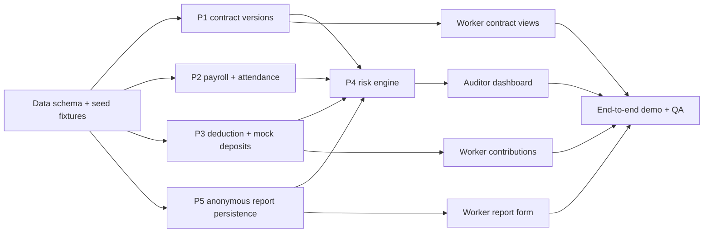

# JagaJKN — Rapid MVP Implementation Plan

**Document:** `docs/PLAN.md`  
**Companion:** [`SPEC.md`](./SPEC.md)  
**Plan type:** Time-boxed proposal for a 6-day rapid prototype; adjust dates/team size to the event schedule.  
**Rule:** No feature development until `SPEC.md` P0 decisions and three demo anomaly cases are accepted.

## 1. Scope locked for implementation

**Build:** One Next.js / TypeScript app, one PostgreSQL database, three role portals, business modules P1–P5, logical stores D1–D5, deterministic scoring, mock BPJS and HR source data. No microservices, no actual institutional integrations, no ML, no real identity data.

**North-star demo:** A synthetic source-data change reaches the auditor risk leaderboard, with a traceable explanation, in a reliable **3–5-minute walkthrough**. A worker can inspect their own records and file an anonymous report with safe aggregation.

### Non-negotiable product rules

- New HR contract version never overwrites an old one.
- P2 compares payroll/presensi with the contract effective for the period.
- P3 reconciles comparable **employee 1%** amounts only; a missing confirmation is not proof of non-payment.
- P4 uses explicitly documented, versioned demo rules and returns `INSUFFICIENT_DATA` when necessary.
- P5 stores no reporter identity; P4 sees only thresholded company counts.
- Auditor does not read raw individual worker data and cannot automatically impose sanctions.

## 2. Delivery strategy / critical path

**Critical path:** Fixture correctness → P1/P2/P3 outputs → P4 indicator aggregation → auditor view → full demo. Worker P5 UI can proceed in parallel once database/auth foundations are stable.

## 3. Milestones and deliverables

| Milestone | Recommended timebox | Deliverable | Exit gate |
|---|---|---|---|
| **M0 — Scope & fixture lock** | Day 0, half day | Approved spec; scenario list; scoring rule table; mock confirmation component decided | Team can explain P1–P5 data flow and the difference between `MISMATCH` and `UNVERIFIED` |
| **M1 — Foundation** | Day 1 | App shell; Prisma/Postgres schema; migrations; seeded accounts, 5 companies/100 workers; scoped demo sessions | Login for each role; seed/reset repeatable; company/worker isolation tests pass |
| **M2 — Evidence pipeline** | Day 2 | P1 immutable versions + feedback; P2 attendance/payroll imports + rules; P3 deductions and mock confirmations | Unit tests demonstrate each process produces correct persisted outputs |
| **M3 — Risk engine & auditor** | Day 3 | P4 indicator builder, score snapshots, coverage logic; auditor list/detail | A/B/C/D sample companies show expected 60/30/insufficient/0 state |
| **M4 — Worker & reports** | Day 4 | Worker contract/history, contribution status, P5 anonymous reporting + suppression | Worker only sees own records; no P5 reporter ID stored; auditor sees aggregates only |
| **M5 — Polish & release** | Day 5 | Responsive UI, error/empty states, role-based walkthrough, deployment, QA | All AC01–AC14 pass or documented blockers; timed 3–5 min demo succeeds |
| **M6 — Buffer / rehearsal** | Day 6, if available | Fix defects, gather screenshots, demo backup recording, finalize pitch | Two clean-reset demo rehearsals without manual DB changes |

**Mapping to the presentation's v1–v4 roadmap:** M0–M1 implement *Foundation*, M2–M3 *Core Prototype*, M4–M5 a focused *Feature Complete* demo. *Expansion* (institutional pilot, ML, real BPJS/WLKP/IoT integrations) is after MVP.

## 4. Executable work breakdown

### M0 — Scope and data-contract lock

- [ ] Confirm three actor permissions and decide demo sign-in identities.
- [ ] Lock P1–P5 input, store and output fields from SPEC §3.
- [ ] Define `period = YYYY-MM`, synthetic IDR amounts, company/worker IDs.
- [ ] Create at least five named synthetic-company stories; cover P1, P2, P3, P5, clean and insufficient-evidence cases.
- [ ] Confirm P3 mock source includes **`confirmedEmployeeShareAmount`** (not just `confirmedTotalAmount`).
- [ ] Approve deterministic P4 weights 25/30/35/10 *for demo only*, the six evidence indicators in SPEC §7.1a, and `ruleVersion`.
- [ ] Freeze P0 route/page set; move feature ideas to P1 backlog.

**Output:** fixture sheet, status dictionary, risk-rule examples and approved spec.

### M1 — Application foundation and data model

- [ ] Set up one Next.js App Router + TypeScript + Tailwind codebase.
- [ ] Provision Postgres and Prisma schema/migration; D1–D5 are table groups.
- [ ] Seed HR, Worker and Auditor roles using synthetic identities; restrict requests on server.
- [ ] Add scoped repository queries (HR company, worker self, auditor summary).
- [ ] Seed 5 companies, >=100 workers, effective contract versions, monthly attendance/payroll and contributions.
- [ ] Add demo reset with server-only/operator access and deterministic random seed.
- [ ] Test invalid worker/company IDs and cross-tenant/role requests.

**Output:** seeded system with working scoped sessions and reproducible data.

### M2 — P1/P2/P3 evidence services

**P1: contract service**
- [x] Create/publish contract version in a transaction; do not mutate old versions.
- [x] Query contract version effective at period and query all versions for worker.
- [x] Store protected contract feedback linked to worker + version.
- [x] Derive P1 `STATUS_FEEDBACK_DISPUTE` as an explicitly *reported* concern.

**P2: wage consistency service**
- [x] Import/validate monthly attendance/payroll fixtures with descriptive errors.
- [x] Implement deterministic comparison of fixed wage/allowance against effective contract.
- [x] Implement optional review signal for repeatedly fixed-value "variable" allowance across 3 periods with stable attendance.
- [x] Output triggered/not-triggered and unavailable evidence state with explanation.

**P3: reconciliation service**
- [x] Store 1% deductions and mock BPJS company-period confirmations.
- [x] Match using company + period + **employee-share basis**; reject unequal field bases.
- [x] Generate MATCHED / MISMATCH / PENDING / UNVERIFIED with human-readable reason.
- [x] Ensure only confirmed comparable differences can trigger P4 `CONTRIBUTION_DELTA`.

**Output:** tested service functions and persisted evidence/results; UI is minimal at this stage.

### M3 — P4 and auditor experience

- [x] Convert P1/P2/P3 outputs into normalized, explainable `RiskIndicator` records; keep P1 rapid status changes as review-only context.
- [x] Query P5 **company-level count** adapter, default zero when reporting channel operational.
- [x] Implement 25/30/35/10 scoring and one-trigger-per-category rule.
- [x] Track COMPLETE/INCOMPLETE evidence coverage and `INSUFFICIENT_DATA` label.
- [x] Persist each `RiskAssessment` with `ruleVersion`, period, timestamp and indicators.
- [x] Build auditor ranking with separate insufficient-data queue and drill-down.
- [x] Test all six documented evidence indicators, baseline and changed input: assessment history preserved, score changes predictably.
- [x] Keep auditor DTOs aggregated; add explicit `Synthetic demo` and `not fraud proof` copy.

**Output:** judge can see main product value without worker screens being complete.

### M4 — Worker transparency and P5 protected reporting

- [x] Build worker contract view, version timeline, and P1 feedback submit form.
- [x] Build contribution timeline with honest company-period status labels and reasons.
- [x] Build P5 categorical report form; do not require/upload free-text attachments.
- [x] On submission, determine company from authorized session but **do not persist worker ID/session/IP** with report; disable identifying request-body/access logging for reporting path.
- [x] Aggregate reports by company/period and show only counts >=3 to auditor/P4.
- [x] Confirm a newly submitted report cannot be searched back to a worker identity.
- [ ] Add optional in-app notice only after core views are correct.

**Output:** protected worker loop with cross-role access tests.

### M5–M6 — UI polish, QA and rehearsal

- [x] Provide consistent nav, typography, status badges and accessible controls for three portals.
- [x] Implement loading, empty, 403/404, validation and server-error/retry states.
- [x] Use colored risk cues **with explicit text**, explanatory tooltips and evidence provenance.
- [ ] Run all acceptance tests from SPEC §10, including at least one clean control.
- [x] Test direct-link access to forbidden routes/API and company ID tampering.
- [ ] Deploy to demo environment; verify Postgres connectivity and seeded logins.
- [ ] Rehearse reset → HR version change → P2/P3 evidence → P4 recalculation → auditor ranking → worker report.
- [ ] Create a backup video/screenshots and a one-page demo operator script.

**Output:** stable, understandable demonstration, not additional feature breadth.

## 5. Team workstreams and parallelization

| Workstream | Owns | Depends on | Can run in parallel with |
|---|---|---|---|
| **Domain/data/backend A** | Schema, seed, scoped repositories, P1/P2 | M0 | UI shell |
| **Backend B** | P3 adapters/reconciliation, P4 scoring | Stable schema + fixture contracts | Worker screens |
| **Frontend** | Role portals, auditor leaderboard/detail, UI states | Mock typed API contracts | Backend service tests |
| **QA/demo integration** | Golden fixtures, permissions, E2E, deployment, demo script | Initial seed | All streams continuously |

For a smaller team, keep one owner per module and integrate at least daily. Assign a single maintainer to shared schema, shared DTOs, and risk-rule changes to avoid conflicting AI-generated implementations.

### AI coding agent execution rules

1. **Read `docs/SPEC.md` and `docs/PLAN.md` before any change.**
2. Work on one milestone/task with explicit file ownership; no parallel agents editing Prisma schema simultaneously.
3. Require a changed/added test for any service rule or access policy modification.
4. Return brief evidence: files changed, tests run, demo effect, remaining blockers.
5. Prefer existing primitives and small functions; do not add message queues, microservices, LLM calls, ML frameworks, or unnecessary component libraries.
6. UI mockups cannot substitute for a persisted, computed P1→P4 pipeline.
7. If rule interpretation or monetary basis is uncertain, implement an **unverified/incomplete** state rather than fabricating certainty.

## 6. Testing plan and quality gates

| Layer | Required coverage | Milestone |
|---|---|---|
| **Unit** | Contract effective-version selection, immutable publish, P2 anomaly rules, P3 status/tolerance, P4 scoring thresholds/coverage | M2–M3 |
| **Integration** | P1/P2/P3 changes persist and produce versioned P4 assessments; D4 aggregate count enters P4 without source identity | M3–M4 |
| **Authorization** | HR cannot access other company; worker cannot access others; auditor cannot fetch raw worker records; reset operator only | M1, M4 |
| **Privacy** | P5 DB schema and API contain no reporter ID/contact/IP/session; counts below 3 suppressed | M4 |
| **UI/E2E** | Seeded demo flows plus 403/404/empty/UNVERIFIED/INSUFFICIENT_DATA visual states | M5 |
| **Presentation** | 3–5 min demonstration from fresh reset; no manual database intervention | M5–M6 |

### Golden example assertions

- Company A: P1 25 + P3 35 = score **60/HIGH** when all requisite data sources exist.
- Company B: P2 30 = **30/MEDIUM** when all requisite sources exist.
- Company C: P3 data absent = **INSUFFICIENT_DATA**, no fabricated numeric delta.
- Company D: all tests clean = **0/LOW**.
- Company E: three protected reports = **10/LOW** with thresholded company count and no reporter data.
- If Company E receives only one/two reports, no P5 risk contribution and the auditor cannot infer who reported.
- Re-publishing one worker's contract must not alter historical `ContractVersion` contents.

**Do not claim 100% fraud detection.** The goal is 100% correct outputs on the *known synthetic golden fixtures* plus no false flags for clean cases.

## 7. Feature cut order if the schedule slips

Keep **P1 versioning, P2 consistency, P3 reconciliation, P4 explainable scoring, company-level auditor dashboard, P5 anonymous aggregation, and basic worker transparency**.

Cut, in this order:

1. Notifications via email/SMS and elaborate animation.
2. CSV import UI (keep deterministic seed and a small edit form).
3. Advanced auditor case management and exports.
4. Sophisticated risk analytics charts, historical trend visuals.
5. Search, complex filters, rich settings and branded onboarding.

**Never cut:** role isolation, missing-data semantics, P5 privacy, actual scoring/persistence, reproducible demo fixtures, or honest mock labels.

## 8. Demo runbook (3–5 minutes)

| Time | Presenter action | Point demonstrated |
|---|---|---|
| 0:00–0:30 | Open auditor overview and introduce a fictional company's current state | BPJS goal and transparent risk ranking |
| 0:30–1:10 | HR publishes a new contract version; open history | P1 source traceability |
| 1:10–1:50 | Show attendance/payroll comparison and seeded discrepancy | P2 signal with a reason |
| 1:50–2:30 | Show 1% deductions versus mock BPJS employee-share confirmation | P3 comparable reconciliation and clear uncertainty |
| 2:30–3:30 | Recompute and inspect auditor company detail | P4 explainable score, priority and coverage |
| 3:30–4:30 | Worker checks contract/contribution and submits categorical report | Worker transparency, P5 privacy, count-only aggregation |
| 4:30–5:00 | Close with limitations and next steps | Human-in-the-loop, no real integration or fraud verdict |

If the live dataset becomes unstable, reset to seed; never edit DB manually during the presentation.

## 9. Definition of done and sign-off

MVP is **demo-ready** only if:

- [ ] All P0 features F01–F12 in SPEC §4 work end-to-end or a formally accepted deviation is documented.
- [ ] Every acceptance gate AC01–AC14 passes, with test evidence and screenshots if relevant.
- [ ] Mock data is labeled everywhere it matters, especially BPJS confirmations.
- [ ] No cross-role data exposure or P5 reporter identifier persistence is observed.
- [ ] At least two clean-reset demo rehearsals succeed in the target presentation environment.
- [ ] The live operator can explain the score breakdown and the difference between **risk signal**, **data discrepancy**, and **proven violation**.

### Post-MVP roadmap (explicitly deferred)

Pilot with 1–3 willing employers and written data-sharing approval; validate wage and deduction rules with BPJS subject matter experts; calibrate false positives and score weights against audited cases; explore real BPJS/WLKP/payroll adapters, retention controls, and independently reviewed privacy/security protections. Real-world deployment requires legal and institutional governance beyond this hackathon prototype.
