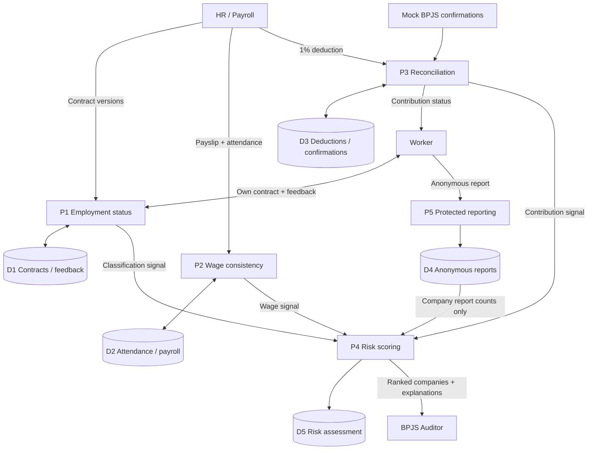
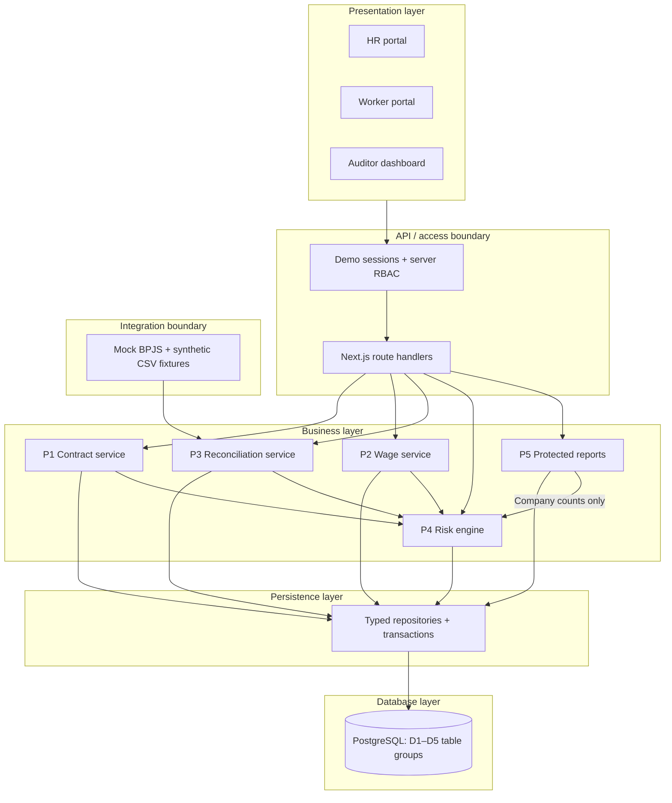

# JagaJKN — MVP Product & Technical Specification

**Document:** `docs/SPEC.md`  
**Status:** Proposed MVP specification; implementation decisions subject to team approval  
**Product:** JagaJKN — *Dari Upah hingga Setoran, Kepatuhan Iuran JKN yang Transparan dan Dapat Diverifikasi*  
**Sources:** Sambak — Healthkaton presentation, Brainstorming document, and the team's clarified P1–P5 / D1–D5 data flow (8 October 2026).

> **Source vs proposal:** The product problem, five processes, five logical data stores, three user groups, and constraints on automated fraud decisions come from the team's context. Routes, schema fields, scoring thresholds, framework choices, and implementation details below are **MVP design proposals**, not claims made in the presentation.

## 0. Executive decision

Build **one demonstration-ready, role-based web application** with three connected portals (HR, Worker, Auditor). Seed 100 synthetic workers across 5 fictional companies. Implement the **actual data-processing logic** of P1–P5, with an explainable, deterministic company risk score. Mock institutional integrations. Focus the live demo on **HR input → persisted evidence → verification → risk ranking → auditor review**, with a complementary worker journey.

**Definition of product success:** A judge can see a realistic company move in the audit priority list after changing synthetic source data, understand **which indicators changed**, and see that workers can inspect contribution status and submit protected reports—without the product making an unsupported accusation of fraud.

**Primary demo differentiator:** Traceability across contract versions, attendance/payroll, deductions versus confirmation of deposit, and protected worker feedback; not an ML model or a large number of dashboards.

## 1. Problem statement and target users

### 1.1 Problem

JKN contribution oversight is hard when company-reported employment classification, wage components, payroll deductions, and contribution settlement cannot easily be reconciled against supporting records. Three connected risks motivate JagaJKN:

1. **Employment relationship misclassification:** contractual labels may not reflect the worker's reported work arrangement, potentially shifting obligations away from the employer.
2. **Under-reporting of the wage basis:** fixed versus variable compensation can be classified inconsistently with contracts and attendance patterns, potentially changing the contribution basis.
3. **Deducted-but-unconfirmed contributions:** a worker can see a 1% deduction on payroll but lack visibility into whether the corresponding contribution has been confirmed as deposited.

**Problem statement:** How might BPJS auditors prioritize verification of employers using cross-source risk signals, while workers gain transparent access to their contracts and contribution status and employers provide traceable records?

**Important domain guardrail:** The team's 4% employer + 1% worker = 5% illustration defines the *demo scenario*. Applicable wage base rules, caps, exclusions, deadlines, and legal classifications must be validated with domain experts before any production use. The prototype does not make legal findings.

### 1.2 Personas and authorization boundaries

| Persona | Jobs to be done | MVP permissions | Explicit restriction |
|---|---|---|---|
| **HR / Payroll (company-scoped)** | Maintain contract versions, attendance, payroll, employee deductions | Read/write own company's workers and source records; inspect import validation | Cannot view other companies or identify anonymous P5 reporters |
| **Worker (self-scoped)** | View active contract/version history and deductions, give contract feedback, file a protected report | Read own contract and contribution timeline; write P1 feedback and P5 report | Cannot inspect another worker or auditor-only scores |
| **BPJS Auditor (aggregated scope)** | Prioritize company checks and explain risk signals | View company-level risk list, indicator summaries, source completeness, review notes | No raw worker contracts, payslips, free-text reports, or report identity in MVP |

Seeded **demo identities**, not public self-registration. Only fictional/synthetic data is permitted.

## 2. Primary user journeys

### 2.1 Core path: source data to audit ranking

1. HR signs into the **HR Portal**, selects their fictional company, and reviews its employees.
2. HR creates/updates a contract; **P1** adds a **new immutable `ContractVersion`** to **D1** rather than overwriting the previous version.
3. HR enters/imports payslips and attendance; **P2** stores them in **D2**, evaluates contract/payroll/attendance consistency, and emits **wage inconsistency indicators**.
4. HR supplies worker 1% deduction records; a **mock BPJS source** supplies confirmation records. **P3** stores both in **D3**, reconciles comparable company-period amounts, and produces contribution status for workers and discrepancy indicators for **P4**.
5. A worker checks their contract through **P1**, may file **contract feedback** (creating a self-reported P1 signal), and/or files a separately protected report through **P5**, which stores a de-identified record in **D4**.
6. **P4** consumes P1/P2/P3 indicators and **company-level report counts from D4**; it calculates an explainable company score, completeness status, and audit priority, then persists each assessment in **D5**.
7. Auditor opens the **Auditor Dashboard**, sorts companies by risk/priority, selects one, reads **redacted company-level explanations**, and records an optional review decision. Human follow-up is required before any conclusion.

### 2.2 Worker journey

`Sign in → My contract → Previous versions → Submit discrepancy feedback → My contributions (deducted / confirmed / pending / unverified) → Submit anonymous suspected violation → Submission receipt`.

**Distinction:** P1 *contract feedback* is linked to a worker's contract for internal checking (access-restricted); P5 *suspected-violation reports* are stored **without reporter identifiers** and only aggregate counts are exposed to P4. Do not merge these two workflows.

### 2.3 Required live demonstration (3–5 minutes)

- Show a seeded company and its baseline score.
- As HR, publish a second version of a contract; verify v1 remains readable in history.
- Show payroll/attendance evidence and one flagged inconsistent wage component.
- Show a seeded HR deduction versus mock-BPJS confirmation discrepancy; explain why the amounts are comparable and why missing evidence is **not** automatically a mismatch.
- Recompute/refresh; auditor sees updated indicators, composite score, audit priority, and data completeness.
- As worker, inspect the contribution timeline and submit a protected report; auditor only sees a thresholded aggregate count, not reporter identity.

## 3. Process and store contract (authoritative data flow)

| Process | Input and actor | Store (logical) | Outputs/consumers | Invariant |
|---|---|---|---|---|
| **P1 — Check employment status** | HR contract changes; worker contract feedback | **D1 — Versioned contracts** (+ restricted feedback) | Active contract to worker; misclassification indicator to P4 | Updating does not delete historical versions; P1's self-report is not a legal classification |
| **P2 — Check wage-component consistency** | HR payslips and attendance | **D2 — Attendance and wages** | Wage inconsistency indicator to P4 | Compare compatible periods and documented classification rules; signal ≠ proven under-reporting |
| **P3 — Reconcile contributions** | HR 1% deduction records; BPJS confirmation data (mock in MVP) | **D3 — Deductions and deposits** | Worker status/notification; deposit discrepancy to P4 | Compare **the same contribution component**, company, and period; missing confirmation ≠ failed deposit |
| **P4 — Compute risk and audit priority** | Indicators P1/P2/P3; company-level report counts from D4 | **D5 — Risk assessments and indicators** | Company score and prioritized list to auditor | Score is for human triage, never automatic verdict or sanction |
| **P5 — Receive worker reports** | Worker suspected-violation report | **D4 — Anonymous reports** | Count per company to P4 | Do not persist reporter user ID, email, IP, or linkable identifiers with report |

**D1–D5 are logical data stores**, not five separate physical databases and not a reference to Cloudflare D1. Implement as table groups inside one database for MVP.



## 4. MVP feature inventory and explicit non-goals

### 4.1 P0: must work end-to-end

| ID | Feature | Observable behavior |
|---|---|---|
| F01 | Role-separated demo sign-in | Select seeded identity; server rejects requests outside its scope |
| F02 | HR company/employee view | HR can browse and select workers from their own company |
| F03 | P1 contract versioning | Create initial contract and publish new version; preserve past versions and effective dates |
| F04 | P1 worker contract + feedback | Worker views own active/history; submitted feedback creates a traceable *self-reported* indicator |
| F05 | P2 attendance/payroll input | Seeded records plus simple validated CSV/form imports; mismatches are computed on demand |
| F06 | P2 wage rules | Detect documented inconsistent payroll components against contract and attendance; give reason |
| F07 | P3 deduction/confirmation | Store deduction and mock deposit data; derive MATCHED, MISMATCH, PENDING, UNVERIFIED statuses |
| F08 | Worker contribution timeline | Worker views 1% deductions and **company-period reconciliation status**, accurately labeled |
| F09 | P5 anonymous reporting | Store category + restricted, non-identifying fields; aggregate company counts with suppression threshold |
| F10 | P4 deterministic scoring | Calculate per-company score, rule triggers, data coverage and risk labels; persist run snapshot |
| F11 | Auditor dashboard + drill-down | Sorted audit priorities, company explanation, provenance, completeness, manual review status |
| F12 | Demo dataset + reset | Seed >=100 fictional workers / >=5 fictional companies; replay expected anomaly cases reliably |

### 4.2 P1: only if P0 passes

- In-app notification center for new deductions, changed contract, and reconciliation status.
- Search/filter/export **company-level** audit priority list.
- Basic auditor review note and `NEEDS_REVIEW / IN_REVIEW / CLOSED` status.
- Polished empty states, gentle transitions, responsive layouts, and demo-friendly guides.

### 4.3 Explicit non-goals

- Production BPJS, WLKP, inter-agency, corporate HRIS, payroll, or IoT connections.
- ML anomaly detection, model training, LLM agents, predictive fraud probabilities.
- Real money movement, billing, collecting JKN contributions, or processing claims.
- Automated legal employment reclassification, fraud accusations, fines, or company sanctions.
- Full attendance collection via fingerprint, facial recognition, GPS, or clock-in hardware.
- Multi-tenant enterprise onboarding, public signup, SSO, advanced workflows, or high-scale distributed infrastructure.
- Real identity/contact or sensitive health data collection; uploading real contracts or payslips.
- Worker-level proof of receipt based solely on **company-level** BPJS deposit totals.

## 5. Required screens and UI states

**Global state contract:** loading/skeleton; no records; success; validation error; server error/retry; forbidden (403); not found (404). Every data-dependent screen shows a *synthetic-data* banner. Never render `UNVERIFIED` as `MISMATCH`.

| Route (proposed) | Persona | Must show | Domain-specific states |
|---|---|---|---|
| `/login` | All | Seeded role/account cards and dataset notice | Ready, signing-in, failed |
| `/hr` | HR | Company counts, employee list, ingestion status, shortcuts | No workers, data complete/incomplete |
| `/hr/workers/[id]` | HR | Contract editor/history, attendance/payroll, deduction tabs | Draft, active, superseded, expired; missing/invalid import |
| `/worker` | Worker | Contract summary, deductions status, report CTA | No contract, pending, verified, insufficient evidence |
| `/worker/contract` | Worker | Full active contract, version timeline, feedback form | Feedback draft/submitted; no active contract |
| `/worker/contributions` | Worker | Period, deducted share, available reconciliation outcome and explanation | MATCHED, MISMATCH, PENDING, UNVERIFIED |
| `/worker/report` | Worker | Protected categorical report form, privacy notice, receipt | Ready, invalid, submitted, server error |
| `/auditor` | Auditor | KPI cards, ranked companies, risk breakdown, coverage, filters | Calculating, scored, incomplete data, no companies |
| `/auditor/companies/[id]` | Auditor | Score, triggered rules, masked evidence, per-period trends, review action | HIGH/MEDIUM/LOW/INSUFFICIENT_DATA; review states |

**UI design priorities:** credible government/financial-data visual hierarchy; dense but readable audit table; always provide a textual explanation alongside score colors; clear `Synthetic Demo Data` label; large contrast between *confirmed discrepancy* and *awaiting confirmation*. Do **not** spend MVP time on 3D, complex animation, or an AI chatbot.

## 6. Data model and entity interactions

### 6.1 Proposed entities

**Common identity / tenancy**

| Entity | Essential fields | Constraints |
|---|---|---|
| `Company` | `id`, `name`, `externalCode`, `createdAt` | Unique company code |
| `User` | `id`, `displayName`, `role`, `companyId?`, `workerId?` | Roles: HR, WORKER, AUDITOR; references scoped by role |
| `Worker` | `id`, `companyId`, `workerCode`, `displayName` | Unique workerCode per company; synthetic identities only |

**D1 — Contract and worker feedback**

| Entity | Essential fields | Constraints |
|---|---|---|
| `ContractVersion` | `id`, `workerId`, `versionNo`, `effectiveFrom`, `effectiveTo?`, `employmentType`, `baseWage`, `fixedAllowance`, `expectedHoursPerMonth`, `createdAt`, `createdBy` | Unique `(workerId,versionNo)`; never update financial/contract content in an existing version |
| `ContractFeedback` | `id`, `workerId`, `contractVersionId`, `category`, `claimedRegularSchedule`, `createdAt`, `status` | Restricted worker-linked feedback, separate from anonymous reports |

**D2 — Attendance and wages**

| Entity | Essential fields | Constraints |
|---|---|---|
| `AttendanceRecord` | `id`, `workerId`, `period`, `actualHours`, `overtimeHours`, `sourceTag` | Unique worker-period for simplified monthly MVP |
| `PayrollRecord` | `id`, `workerId`, `period`, `baseWageReported`, `fixedAllowanceReported`, `variableAllowanceReported`, `reportedContributionBase` | Unique worker-period; explicit nominal values and period |

**D3 — Deductions and deposits**

| Entity | Essential fields | Constraints |
|---|---|---|
| `DeductionRecord` | `id`, `workerId`, `companyId`, `period`, `employeeOnePercentAmount` | Source is synthetic HR payroll; unique worker-period |
| `DepositConfirmation` | `id`, `companyId`, `period`, `confirmedEmployeeShareAmount?`, `confirmedTotalAmount?`, `confirmedAt?`, `reference`, `sourceType` | Source type `MOCK_BPJS` for MVP; identify what monetary component a field represents |
| `ReconciliationResult` | `id`, `companyId`, `period`, `status`, `deductionSum`, `comparableConfirmedSum?`, `delta?`, `reason`, `calculatedAt` | `status` = MATCHED / MISMATCH / PENDING / UNVERIFIED |

**D4 — Protected reporting**

| Entity | Essential fields | Constraints |
|---|---|---|
| `AnonymousReport` | `id`, `companyId`, `period`, `category`, `createdAt` | **No `workerId`, `userId`, name, email, IP address, free-text identity, or auth session ID** |

**D5 — Risk and audit priority**

| Entity | Essential fields | Constraints |
|---|---|---|
| `RiskIndicator` | `id`, `companyId`, `period`, `ruleCode`, `processCode`, `triggered`, `explanation`, `evidenceSummary`, `dataStatus` | `processCode` P1/P2/P3/P5; reference only allowed/redacted evidence |
| `RiskAssessment` | `id`, `companyId`, `period`, `score`, `riskLevel`, `coverageState`, `ruleVersion`, `computedAt` | Unique versioned assessment run; no silent overwrite |
| `AuditReview` (P1 extension) | `id`, `companyId`, `assessmentId`, `reviewerId`, `status`, `note`, `updatedAt` | Human annotations do not alter computed score |

**Supporting data:** `Notification` (worker, period, type, status/readAt) is P1 optional; not a sixth business data store. Use date/month as explicit `YYYY-MM` period and IDR integer amounts (no floating point for money).

### 6.2 Entity relations and consistency rules

- `Company 1—N Worker`; `Worker 1—N ContractVersion`, `AttendanceRecord`, `PayrollRecord`, `DeductionRecord`.
- `ContractFeedback` points to a specific worker and contract version; **P5 report must not**.
- `Company 1—N DepositConfirmation`, `ReconciliationResult`, `RiskAssessment`; `RiskAssessment 1—N RiskIndicator` conceptually (store `assessmentId` in actual schema).
- Contract active at time `T` is determined by version effective dates, not merely highest version number. Reject overlapping effective ranges or specify a deterministic policy.
- P2 uses **contract version effective during the payroll period**, not necessarily the current version.
- P3 compares records only if period, company and confirmed contribution component align. **Never compare employee 1% deductions with a 5% total deposit as if they were the same field.** In the MVP fixtures, provide `confirmedEmployeeShareAmount`. An alternative total-based match requires a separately verified equivalent expected total and is out of P0.
- Company-level confirmation **does not establish individual worker settlement**. Worker UI text: `Potongan Anda tercatat; status pencocokan setoran tingkat perusahaan untuk periode ini: ...`.
- Re-run analysis creates a new `RiskAssessment` with `ruleVersion` and updated provenance; previous assessment remains available for traceability.

## 7. Deterministic risk rules (proposed demo policy, **not regulatory policy**)

### 7.1 Indicators

| Rule | Condition on synthetic fixtures | Source | Weight |
|---|---|---|---:|
| `STATUS_FEEDBACK_DISPUTE` | At least one P1 feedback explicitly indicates a status-work arrangement discrepancy | P1 | 25 |
| `WAGE_COMPONENT_INCONSISTENCY` | Either: (a) reported fixed wage/allowance disagrees with period-effective contract; or (b) synthetic 3-period variable allowance is unchanged with stable attendance, raising a **review signal** | P2 | 30 |
| `CONTRIBUTION_DELTA` | P3 has **comparable**, confirmed employee-share and HR deductions, and absolute delta > `max(IDR 1,000, 1% of deductions)` | P3 | 35 |
| `REPORT_CLUSTER` | At least **3** company reports in the same reporting window (only count, no identity or narrative) | P5 | 10 |

Each rule contributes its weight **once per company and period** (no multiplication by number of employees or reports). P1/P2/P3 indicate reasons to inspect, not that a violation occurred. A report count smaller than 3 is not displayed or incorporated into public/aggregated scoring, to reduce re-identification risk.

### 7.1a Six explicit evidence indicators

The presentation targets **at least six documented indicators**. The four weighted scoring categories above **group** six granular evidence rules below; do **not** add the same category weight multiple times for multiple sub-signals.

| Evidence indicator code | Related scoring category | Meaning |
|---|---|---|
| `P1_WORKER_STATUS_DISPUTE` | `STATUS_FEEDBACK_DISPUTE` | Worker states contract employment classification does not match reported arrangement |
| `P1_RAPID_STATUS_VERSION_CHANGES` | P1 review context only in P0 | Two or more classification changes over a three-month history; **informational**, not automatically a violation |
| `P2_FIXED_COMPONENT_CONTRACT_DIFFERENCE` | `WAGE_COMPONENT_INCONSISTENCY` | Reported fixed wage/fixed allowance differs from period-effective contract |
| `P2_RECURRING_VARIABLE_COMPONENT` | `WAGE_COMPONENT_INCONSISTENCY` | Identical declared variable allowance in three consecutive months with stable attendance; review-only suspicion |
| `P3_CONFIRMED_EMPLOYEE_SHARE_DELTA` | `CONTRIBUTION_DELTA` | Difference between comparable 1% deduction aggregate and confirmed 1% aggregate beyond tolerance |
| `P5_REPORT_COUNT_THRESHOLD` | `REPORT_CLUSTER` | At least three anonymous reports in the same company/window |

Separately track missing data as an **evidence coverage status**, not as a seventh fraud indicator. For the rapid demo, the P1 rapid-change signal is shown as context and **contributes 0** by itself; score P1 only with feedback dispute.

### 7.2 Score, missing evidence, and ranking

- `score = sum(weight of triggered rules)` in the inclusive range **0–100**. A non-triggered rule counts 0 **only when its input was evaluated and sufficient**.
- `coverageState = COMPLETE` only when P1, P2 and P3 have sufficient relevant records for the requested period; otherwise `INCOMPLETE`. P5 is operational even when there are zero reports.
- If `INCOMPLETE`, display a **provisional observed-indicator score** and risk label **`INSUFFICIENT_DATA`**; do not label the company `LOW` merely because evidence is missing. The display must identify unavailable processes.
- With COMPLETE coverage: `LOW = 0–19`, `MEDIUM = 20–49`, `HIGH = 50–100`.
- Audit priority order: HIGH first by descending score, then MEDIUM, then LOW; show INSUFFICIENT_DATA in a visible separate queue for evidence completion. No fraud designation.
- All weights, thresholds, and rule logic are **demo configuration** that require auditor validation before any real use. Do not output a probability of fraud.

### 7.3 Reconciliation semantics

1. `PENDING`: confirmation not yet expected under the **fixture's configured reporting window/due date**.
2. `UNVERIFIED`: missing confirmation, non-comparable amount basis, or insufficient evidence; no numeric delta should be manufactured.
3. `MATCHED`: a confirmed comparable employee-share amount exists and absolute delta is within tolerance.
4. `MISMATCH`: a confirmed comparable employee-share amount exists and delta exceeds tolerance; this is a *data discrepancy*, not proof of misuse.

When data changes, recompute P2/P3 indicators and P4 score deterministically. Keep input/assessment period consistent.

## 8. Technical architecture

### 8.1 Delivery architecture

**Recommended stack (proposal):** Next.js App Router + React + TypeScript + Tailwind CSS for UI; Next.js Route Handlers for JSON API; service layer (pure TypeScript functions) for P1–P5; Prisma + hosted PostgreSQL for durable data. Use one application/deployment and one database. Use simple server-rendered views where practical; avoid a client-state framework unless needed.



**Security boundary:** Never authorize from frontend-selected role alone; every API read/write must check session role, tenant/company, and worker self-scope. Auditor APIs return **aggregated redacted DTOs**, not raw ORM rows.

### 8.2 Suggested repository structure (no application code)

```text
app/
  (auth)/login/
  (hr)/hr/
  (worker)/worker/
  (auditor)/auditor/
  api/
src/
  domain/                 # shared types + risk rule definitions
  services/               # p1-contract, p2-wage, p3-reconcile, p4-risk, p5-reports
  repositories/           # database access, scoped queries, transaction boundaries
  integrations/           # mock BPJS adapter and fixture reader
  auth/                   # demo session, auth guards and RBAC
  validation/             # input schemas
  demo/                   # seeded scenarios and reset mechanism
prisma/                   # schema + migrations + seed
public/
tests/                     # unit + integration + end-to-end smoke tests
docs/SPEC.md
docs/PLAN.md
```

### 8.3 Proposed API surface

| Method / route | Role | Core action |
|---|---|---|
| `POST /api/demo/session` | Public demo-only | Enter a seeded identity; server creates scoped session |
| `GET /api/hr/workers` | HR | List company workers |
| `POST /api/hr/workers/:id/contracts` | HR | Publish **new version**, never replace old version |
| `POST /api/hr/attendance/import` | HR | Validate and upsert company-scoped synthetic monthly records |
| `POST /api/hr/payroll/import` | HR | Validate and upsert monthly payroll records |
| `POST /api/hr/deductions/import` | HR | Validate and upsert 1% worker deductions |
| `GET /api/worker/contract` | Worker | Own active contract and versions |
| `POST /api/worker/contract-feedback` | Worker | Own linked P1 feedback |
| `GET /api/worker/contributions` | Worker | Own deductions plus **labeled company-period** reconciliation status |
| `POST /api/worker/reports` | Worker | Protected P5 categorical report; persist no reporter ID |
| `GET /api/auditor/companies` | Auditor | Ranked companies, completeness and score |
| `GET /api/auditor/companies/:id/risk` | Auditor | Current risk assessment, indicator explanations and redacted summaries |
| `POST /api/demo/recalculate` | Seeded demo operator only | Re-run P1–P4 calculations for seeded dataset |
| `POST /api/demo/reset` | Seeded demo operator only | Restore synthetic data to known baseline; disabled outside demo |

Use runtime schema validation for every write, consistent `YYYY-MM` periods, integer IDR amounts, and stable API errors (`400`, `401`, `403`, `404`, `409`, `500`). Avoid public production API claims.

## 9. Real functionality vs mocked integration

| Capability | MVP mode | Transparency requirement |
|---|---|---|
| Contract persistence/versioning | **Real app logic/database** | Show persisted history |
| Attendance/payroll evaluation | **Real app logic** on synthetic records | Show rule and evidence window |
| P3 reconciliation | **Real app logic** on synthetic confirmations | Always label mock BPJS source |
| P4 scoring/prioritization | **Real app logic** | Show weights, version, coverage, triggered reasons |
| P5 aggregation/anonymization | **Real app logic** | Do not persist reporting worker ID; suppress small counts |
| Three role portals, server-side access checks | **Real prototype logic** | Seeded sign-in rather than public auth |
| HR payroll/attendance source | **Mock source** (CSV/seed) | Not connected to real HRIS/IoT |
| BPJS confirmations | **Mock source** | No claim of official settlement confirmation |
| Institutional data exchange | **Not integrated** | Out of scope / roadmap only |
| Notifications | **In-app mock/dynamic** if P1 time permits | No email or SMS delivery claim |

## 10. Acceptance criteria — testable demo gates

| ID | Pass condition | Verification |
|---|---|---|
| AC01 | >=5 synthetic companies and >=100 synthetic workers exist with documented seed | Seed assertion |
| AC02 | Seed contains at least 3 distinct anomaly scenarios: P1, P2, P3; plus clean and missing-evidence controls | Fixture review |
| AC03 | Changing a contract generates monotonically increasing version; prior version remains unchanged and worker sees expected effective version | DB + UI test |
| AC04 | Worker can view only own contract/period history; HR only own company | Cross-role / cross-tenant API tests return 403/404 |
| AC05 | P2 triggers expected anomalies and does **not** flag the clean control fixture | Deterministic unit tests |
| AC06 | P3 can demonstrate MATCHED, MISMATCH, PENDING, UNVERIFIED, with no comparison of employee share to 5% total | Unit + integration tests |
| AC07 | With a missing P3 confirmation, risk displays INSUFFICIENT_DATA and no false allegation of failed deposit | UI + API test |
| AC08 | P5 persisted report has no reporter IDs/contact/IP/session tokens; auditor API has only thresholded company counts | DB inspection + API snapshot test |
| AC09 | P4 outputs reproducible 0–100 scores, correct 25/30/35/10 contributions, ruleVersion and explanations; seeded anomalies are detected | Golden-fixture tests |
| AC10 | Auditor can rank and drill into company risk without accessing raw worker identity or documents | E2E + authorization test |
| AC11 | Recalculate after a seeded change updates visible risk while preserving assessment history | E2E regression |
| AC12 | At least 1 complete 3–5-minute live demo passes from clean reset without manual DB edits | Timed rehearsal |
| AC13 | All critical screens cover loading, empty, error and domain-specific status; keyboard navigation works for primary actions | UI checklist |
| AC14 | Dataset and every mocked BPJS confirmation are clearly marked `Synthetic / Demo`; no real worker data is loaded | Content review |

**Original presentation goals translated to prototype:** at least 100 workers, 5 companies, 3 anomaly scenarios, 6 documented risk signals, and 100% detection of deliberately seeded anomalies. For rapid P0, four scoring categories above may each contain multiple *sub-signals*; implement and document all **six distinct evidence indicators** in §7.1a by MVP sign-off, without implying six independent production-grade fraud classifiers. "100%" applies only to planted synthetic test cases, not real-world accuracy.

## 11. Seed fixture / demo story requirements

- **Company A — combined high risk:** P1 status-feedback signal + P3 comparable deposit delta => `60`, `HIGH` when P2 data coverage is complete.
- **Company B — wage inconsistency:** P2 triggers => `30`, `MEDIUM`, with payroll, attendance and contract evidence; P1/P3 evaluated clean.
- **Company C — data unavailable:** P3 confirmation absent => `INSUFFICIENT_DATA` with a provisional score, **not `LOW`** and not `MISMATCH`.
- **Company D — clean control:** all sources present, no indicators => `0`, `LOW`.
- **Company E — reporting cluster:** at least 3 synthetic protected reports => P5 report-count trigger (`10`) while no reporter identity is stored.
- At least one additional scenario includes a `PENDING` contribution period within a declared confirmation window.

**Ethical copy requirement:** "Indikator risiko dan hasil pencocokan merupakan sinyal awal untuk diverifikasi auditor; bukan pembuktian fraud atau penetapan kewajiban hukum."

## 12. Privacy, quality, and known limitations

- Synthetic data exclusively. No actual employee identification, payroll bank accounts, patient information or health records.
- Authenticate and authorize every route server-side; use company and self-scoped repository filters.
- **P5 de-identification:** map the company from the authenticated worker context only transiently; persist only company/period/category/timestamp/random ID; also avoid retaining identity-revealing submission details in application or infrastructure request logs. Prefer selectable categories over free text and disable attachments for MVP. Suppress counts under 3 in auditor views; do not show raw report narratives or worker identities.
- **P1 feedback is *not* anonymous**, so limit access and avoid exposing it directly in HR or auditor views; only expose an aggregated/redacted indicator.
- `AuditReview` decisions, when implemented, are human actions; scoring does not initiate sanctions.
- Lack of external confirmation cannot prove non-payment; P3 status semantics must be explicit.
- False positives are expected from atypical work schedules and wage patterns; display the exact rule context, never absolute claims.
- The default score weights, wage rules, legal formula simplification and report suppression threshold are **demo-specific design assumptions** pending institutional validation.
- Protect hosted demo with access controls and reset endpoint restriction; do not expose mutable demo reset to anonymous public visitors.

## 13. Open decisions and product change control

1. Confirm whether all HR/payroll inputs can be synthetic CSV + forms (recommended) rather than simulated real API endpoints.
2. Confirm business interpretation and available granularity of mock BPJS deposit confirmations—**employee-share confirmation** is essential for a direct 1% comparison.
3. Review demo-specific wage rules and threshold with subject matter experts before claiming regulatory correctness.
4. Confirm hosting and database credentials before implementation; use PostgreSQL in both local/dev and demo to prevent migration differences.
5. Decide whether optional notifications and audit review notes fit the hackathon deadline; they must not block P0.

**Engineering rule:** Any new feature must either improve one of the five process invariants, make audit evidence easier to interpret, or strengthen the demo journey; otherwise defer it.
